<picture>
  <source media="(prefers-color-scheme: dark)" srcset="assets/portrait-dark.png" />
  <source media="(prefers-color-scheme: light)" srcset="assets/portrait-light.png" />
  
</picture>

<h1>M. Berk SAM</h1>

**AI-native developer** · Türkiye 🇹🇷

Started with software, evolved into AI. These days most of my side projects begin with *"what if an agent could do this?"* 
Yazılımla başladı, AI'a evrildi. Artık yan projelerimin çoğu *"bunu bir ajan yapabilir mi?"* sorusuyla başlıyor.

🌐 [Website](https://berksam.github.io/berk-sam-site/) 
💼 [LinkedIn](https://www.linkedin.com/in/berksam/) 
📫 [mustafaberksam@gmail.com](mailto:mustafaberksam@gmail.com)

[English](#-english) · [Türkçe](#-türkçe)

 

---

## 🇬🇧 English

**AI-native developer from Turkey.** Alongside my professional work, I build small, focused tools for teams and servers, working with AI agents end to end.

### 🔨 What I'm building

| Project | What it is |
| --- | --- |
| **[Sevkit](https://berksam.github.io/sevkit-landing/)** | Self-hosted deploy, release and server operations. Agent-based, Windows + Linux. .NET 10 + React. |
| **[Lodos](https://berksam.github.io/lodos-landing/)** | A tiny desktop companion for small teams: drop a file or a one-line message onto a dot that lives on your screen. Tauri. |
| **[orkestrasyon](https://github.com/BerkSAM/orkestrasyon)** | A lightweight, file-based protocol for multi-agent development: Claude Code, Codex and Antigravity reviewing each other in roles. |

Feel free to [reach out](mailto:mustafaberksam@gmail.com) for details.

### 💬 Ask me about

Shipping real products with AI coding agents (Claude Code, Codex): multi-agent workflows, agent memory, review loops. Plus C#, .NET, Angular, TypeScript and SQL Server / PostgreSQL.

---

## 🇹🇷 Türkçe

**Türkiye'den AI-native geliştirici.** Profesyonel işimin yanında ekipler ve sunucular için küçük, odaklı araçlar yapıyorum; işin başından sonuna AI ajanlarıyla birlikte çalışıyorum.

### 🔨 Neler yapıyorum

| Proje | Ne işe yarar |
| --- | --- |
| **[Sevkit](https://berksam.github.io/sevkit-landing/)** | Kendi sunucunda çalışan deploy, sürüm ve sunucu operasyon yönetimi. Agent tabanlı, Windows + Linux. .NET 10 + React. |
| **[Lodos](https://berksam.github.io/lodos-landing/)** | Küçük ekipler için masaüstünde duran küçük bir nokta: dosyayı ya da tek satırlık mesajı üstüne bırak, ekibine gitsin. Tauri. |
| **[orkestrasyon](https://github.com/BerkSAM/orkestrasyon)** | Çok ajanlı yazılım geliştirme için dosya tabanlı hafif protokol: Claude Code, Codex ve Antigravity birbirini denetleyen roller halinde. |

Detaylar için [iletişime geçmekten](mailto:mustafaberksam@gmail.com) çekinmeyin.

### 💬 Bana sor

AI kod ajanlarıyla (Claude Code, Codex) gerçek ürün çıkarmak: çok ajanlı akışlar, ajan hafızası, denetim döngüleri. Bir de C#, .NET, Angular, TypeScript ve SQL Server / PostgreSQL.

---

### 🧰 Stack

  

