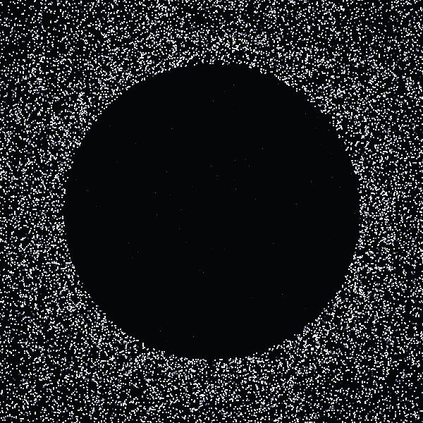

  

<h1 align="center">M. Berk SAM</h1>

  <a href="https://berksam.github.io/berk-sam-site/">Website</a> ·
  <a href="https://www.linkedin.com/in/berksam/">LinkedIn</a> ·
  <a href="mailto:mustafaberksam@gmail.com">mustafaberksam@gmail.com</a>

<a href="#-english">English</a> · <a href="#-türkçe">Türkçe</a>

---

## 🇬🇧 English

**AI-native developer from Turkey.** I build small, focused tools for teams and servers, working alongside AI agents end to end.

### 🔨 What I'm building

| Project | What it is |
| --- | --- |
| **[Sevkit](https://berksam.github.io/sevkit-landing/)** | Self-hosted deploy, release and server operations. Agent-based, Windows + Linux. .NET 10 + React. |
| **[Lodos](https://berksam.github.io/lodos-landing/)** | A tiny desktop companion for small teams: drop a file or a one-line message onto a dot that lives on your screen. Tauri. |
| **[orkestrasyon](https://github.com/BerkSAM/orkestrasyon)** | A lightweight, file-based protocol for multi-agent development: Claude Code, Codex and Antigravity reviewing each other in roles. |

### 💬 Ask me about

Shipping real products with AI coding agents (Claude Code, Codex): multi-agent workflows, agent memory, review loops. Plus C#, .NET, Angular, TypeScript and SQL Server / PostgreSQL.

---

## 🇹🇷 Türkçe

**Türkiye'den AI-native geliştirici.** Ekipler ve sunucular için küçük, odaklı araçlar yapıyorum; işin başından sonuna AI ajanlarıyla birlikte çalışıyorum.

### 🔨 Neler yapıyorum

| Proje | Ne işe yarar |
| --- | --- |
| **[Sevkit](https://berksam.github.io/sevkit-landing/)** | Kendi sunucunda çalışan deploy, sürüm ve sunucu operasyon yönetimi. Agent tabanlı, Windows + Linux. .NET 10 + React. |
| **[Lodos](https://berksam.github.io/lodos-landing/)** | Küçük ekipler için masaüstünde duran küçük bir nokta: dosyayı ya da tek satırlık mesajı üstüne bırak, ekibine gitsin. Tauri. |
| **[orkestrasyon](https://github.com/BerkSAM/orkestrasyon)** | Çok ajanlı yazılım geliştirme için dosya tabanlı hafif protokol: Claude Code, Codex ve Antigravity birbirini denetleyen roller halinde. |

### 💬 Bana sor

AI kod ajanlarıyla (Claude Code, Codex) gerçek ürün çıkarmak: çok ajanlı akışlar, ajan hafızası, denetim döngüleri. Bir de C#, .NET, Angular, TypeScript ve SQL Server / PostgreSQL.

---

### 🧰 Stack

  

  
  

